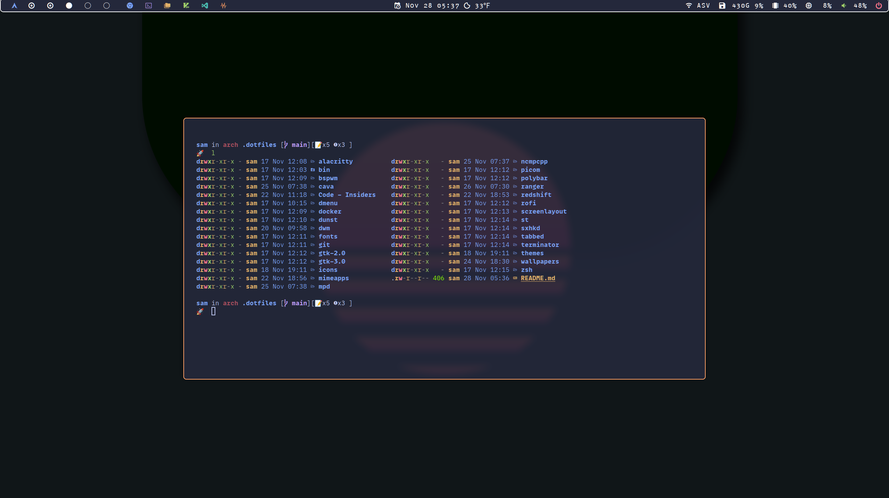
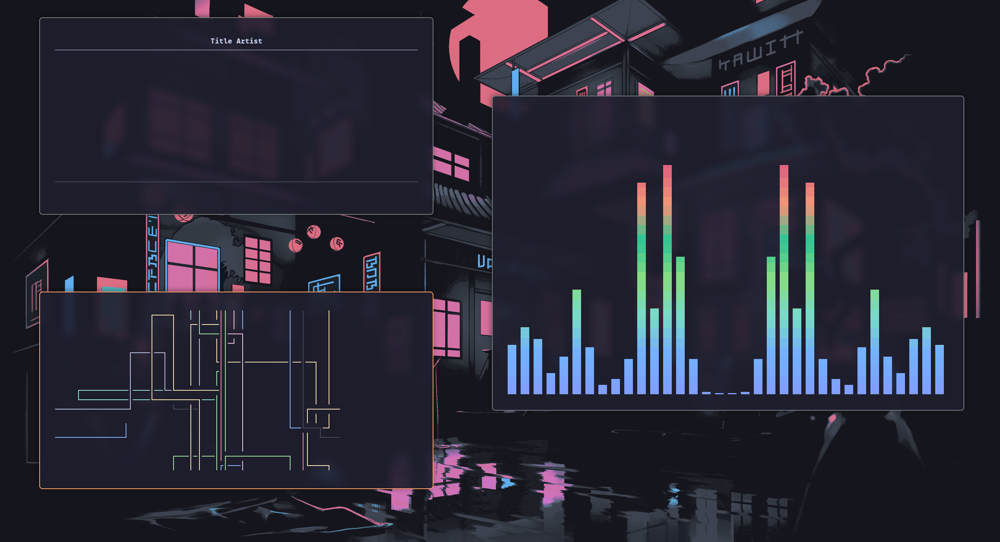
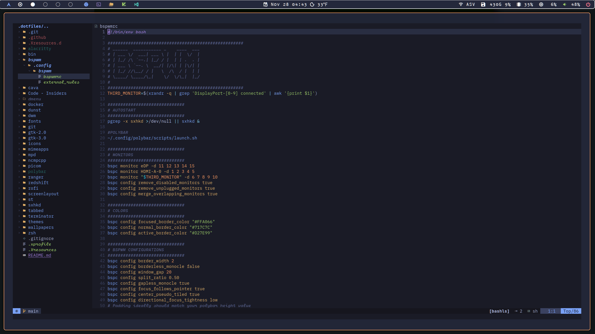
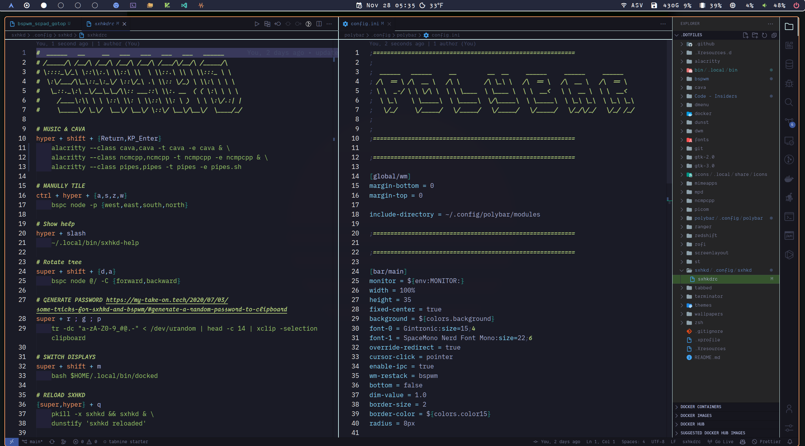
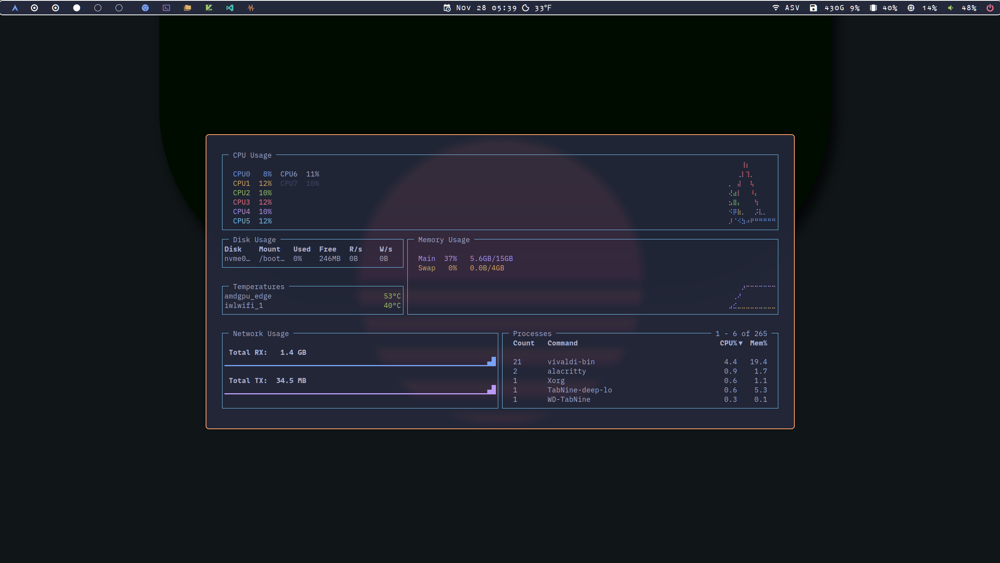

# Dotfiles

My Arch Linux and bspwm configs. Still a WIP.

## Layout

Most folders are a package that mirrors where its files live under `$HOME`:

```text
alacritty/.config/alacritty  ->  ~/.config/alacritty
bin/.local/bin               ->  ~/.local/bin
```

## Setup

There's no install script. Clone the repo, then symlink each package you want:

```sh
git clone git@github.com:rsamhollyer/dotfiles.git ~/.dotfiles
ln -s ~/.dotfiles/alacritty/.config/alacritty ~/.config/alacritty
```

A few things are set up differently:

- **nvim:** the config is at the top of the package, so link `~/.dotfiles/nvim` to `~/.config/nvim`.
- **zsh:** `~/.config/zsh` is a real folder, so link the files inside it individually.
- **systemd:** link individual unit files, because `~/.config/systemd/user` also holds machine-specific links.
- **.xprofile:** `~/.xprofile` must be a real file, not a symlink. Copy it to `$HOME`, and apply any later edits to both copies.

## GE-Proton updates

- `gep-update` installs the latest GE-Proton release into Steam, after verifying its checksum.
- `gep-check` sends a desktop notification when a new release is out. A systemd timer runs it daily.

Both need `curl` and `jq`, and `gep-check` also needs `libnotify` and a running notification service.

Git doesn't track whether the timer is enabled, so set it up on each new machine:

```sh
ln -s ~/.dotfiles/systemd/.config/systemd/user/gep-check.service ~/.config/systemd/user/gep-check.service
ln -s ~/.dotfiles/systemd/.config/systemd/user/gep-check.timer ~/.config/systemd/user/gep-check.timer
systemctl --user daemon-reload
systemctl --user enable --now gep-check.timer
```

After installing an update, restart Steam and select the new version under **Settings > Compatibility**. Old builds aren't removed automatically, so delete them from `~/.steam/root/compatibilitytools.d` when you're done with them.

## Screenshots

### Polybar


### ScratchPad Alacritty



### Cava + NCMPCPP + Pipes.sh



## LunarVim ScratchPad



## VSCode



## Gotop


